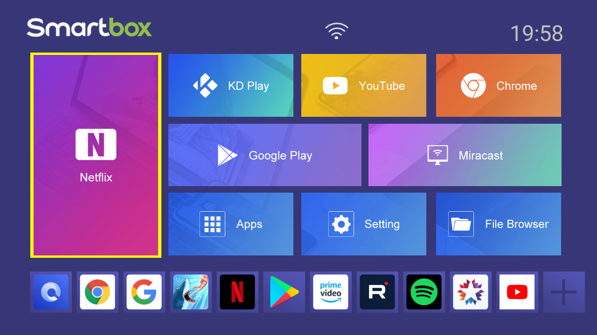
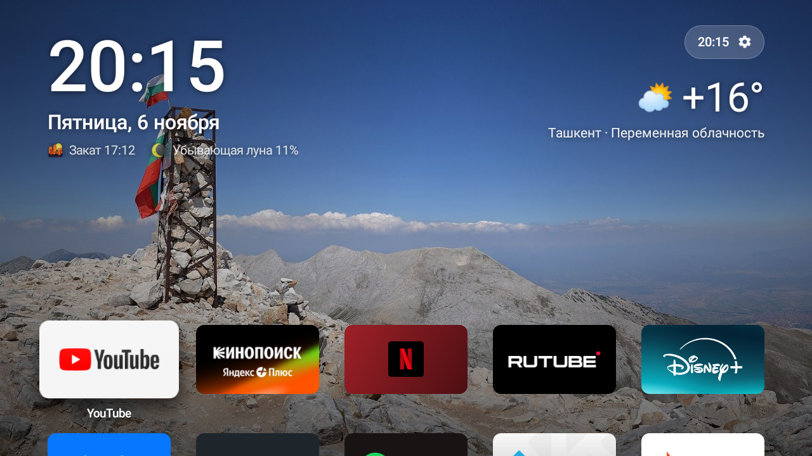
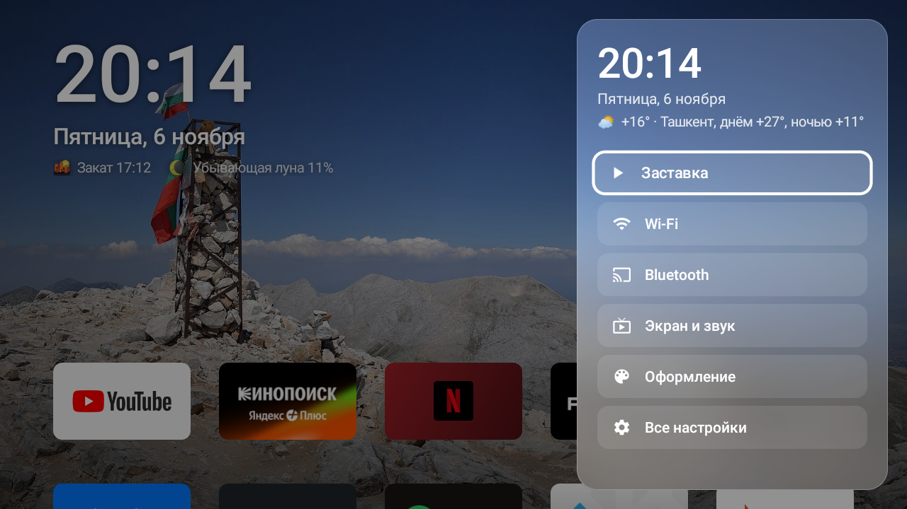
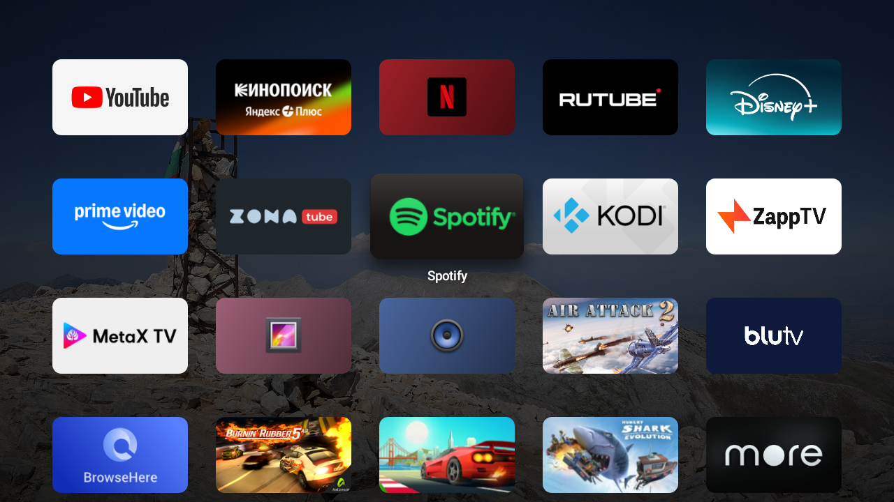

# Vitrina — tvOS-style launcher for X96Q / Allwinner H313 TV boxes

**A lightweight, ad-free home screen in the spirit of Apple TV for cheap Android 10 TV boxes (X96Q, Allwinner H313, Mali-G31, 2 GB RAM)** —
plus notes on the **adware preinstalled in X96Q firmware** and how to remove it.
Kotlin + plain Android Views, no third-party libraries, APK ≈ 140 KB.

> 🇷🇺 [Русская версия ниже](#-по-русски)

## Before / After

| Before — stock “Smartbox” launcher | After — Vitrina |
|---|---|
|  |  |

| Control Center (frosted glass) | App rows |
|---|---|
|  |  |

## Features

- 🖼 **Top shelf** — Wikimedia Commons featured pictures (landscapes, mountains, cities, space), rotated every 20 min, cached offline;
  big clock and date, weather by IP (Open-Meteo, no API key), sunset time and moon phase
- 🟦 **Focus like tvOS** — the focused tile lifts (scale + soft shadow), tilts slightly from the side the focus came from,
  a light sheen sweeps across it and the app name appears below; at the edge of the grid the tile “bumps”
- ⬇️ **Scrolling** — moving down slides the shelf away and dims the wallpaper
- 🪟 **Control Center** (glass pill in the top-right corner) — screensaver, Wi-Fi, Bluetooth, display, appearance, settings
- 📶 **Status** — Wi-Fi signal / Ethernet / offline and Bluetooth icons next to the clock
- ✋ **Menu key on a tile** — move (with the arrows), move to front, hide, uninstall
- 🌙 **Screensaver** — Ken Burns slideshow with an analog clock, dimmed at night
- 🔤 **Readable on any wallpaper** — the shade under the text is computed from the brightness of the photo
- ⭐ Last opened app goes first (until you arrange the tiles yourself)

## Performance on Mali-G31 (60 Hz → 16.6 ms frame budget)

| | Stock launcher | Vitrina |
|---|---|---|
| Frame time while navigating (median / 99th) | 11 / 15 ms, almost no animation | **8 / 15 ms** with animations, 0.12 % janky |
| Launcher memory (PSS) | 43 MB | **33–36 MB** |
| Launcher cold start | 0.9–1.4 s | **0.8–1.0 s** |

How it stays smooth on a weak GPU:
- tiles are pre-rendered bitmaps of the exact size (rounded corners baked in, cached on disk);
- the drop shadow is one pre-blurred bitmap;
- the sheen and gloss are gradients moved by a shader matrix inside `drawRoundRect` (no `clipPath`);
- frosted glass uses the wallpaper scaled down 10× and box-blurred once, and each panel draws its own region;
- scrolling is a single `translationY`, and alpha on flat views has no offscreen layers;
- the wallpaper is kept as a `HARDWARE` bitmap;
- the APK is compiled ahead of time after install.

Full numbers and method: [docs/benchmark.md](docs/benchmark.md).

## Install

Requires JDK 17 and Android SDK 34 to build.

```bash
cd launcher
echo "sdk.dir=/path/to/android-sdk" > local.properties
./gradlew assembleRelease
```

The X96Q firmware has network ADB open on port 5555 (see the security note below).

```bash
adb connect <BOX-IP>:5555
adb install -r app/build/outputs/apk/release/app-release.apk
adb shell cmd package compile -m speed -f io.github.darkknightsoul.vitrina
adb shell cmd package set-home-activity io.github.darkknightsoul.vitrina/.MainActivity
```

On X96Q also disable the stock launcher, otherwise it opens at every boot (it starts before the storage is unlocked):

```bash
adb shell pm disable-user --user 0 com.droidlogic.xlauncher
```

**"Now playing" card on X96Q** needs the launcher installed as a privileged system app (the firmware's `low_ram` mode
disables notification listeners) — see [docs/x96q-firmware.md](docs/x96q-firmware.md#speeding-up-apps).

**Revert to the stock launcher:** `adb shell pm enable com.droidlogic.xlauncher && adb shell cmd package set-home-activity com.droidlogic.xlauncher/.Launcher`

## X96Q firmware: adware and quirks

The tested firmware (`X96Q_20251113-1021`) ships a **dropper** (`com.androidkm.store`, uid system) that silently installs
ad apps (one of them disguised as `com.google.android.adffa`), an **MDM that makes itself Device Owner** on every boot,
Adups remote control and FOTA. Network ADB is open **without authorization**, and `su` is available to `adb shell`.
Indicators, removal steps that worked without reflashing, and a 2× app start-up speed-up are described in
**[docs/x96q-firmware.md](docs/x96q-firmware.md)**.

## Privacy

Network access only to `commons.wikimedia.org` / `upload.wikimedia.org` (wallpapers), `api.open-meteo.com` (weather)
and `ipwho.is` (city for weather).

## License

[MIT](LICENSE). Not affiliated with Apple; “tvOS-style” describes the look only — no Apple assets, fonts or icons are used.

---

## 🇷🇺 По-русски

**Лёгкий главный экран без рекламы в духе Apple TV для дешёвых приставок на Android 10 (X96Q, Allwinner H313, Mali-G31, 2 ГБ ОЗУ).**
Плюс разбор **рекламного ПО в прошивке X96Q** и как его убрать. Kotlin + обычные View, без сторонних библиотек, APK ≈ 140 КБ.

**Возможности:**
- **Витрина сверху:** обои Wikimedia, часы, погода по городу из IP, закат и луна.
- **Плитки по 5 в ряд:** в фокусе плитка приподнимается с тенью, слегка наклоняется, по ней пробегает блик, снизу появляется название.
- **Пункт управления с матовым стеклом**, значки сети и Bluetooth.
- **Кнопка Menu на плитке:** перестановка стрелками, «первым», скрыть, удалить.
- **Заставка** с круглыми часами.
- **Текст читается на любых обоях:** затемнение подбирается по яркости фото.

Плавность на Mali-G31: медиана кадра 8 мс, 0,12 % подвисаний.

**Прошивка X96Q:**
- **Что в ней:** загрузчик рекламы `com.androidkm.store` (системный), MDM, который каждый раз назначает себя владельцем устройства, удалённое управление Adups.
- **Защита:** adb открыт по сети без подтверждения, root у `adb shell`.
- **Как убрать без перепрошивки и как вдвое ускорить запуск приложений** — в [docs/x96q-firmware.md](docs/x96q-firmware.md) (на английском).

**Установка** — команды в разделе [Install](#install).
**Вернуть заводской лаунчер:** `adb shell cmd package set-home-activity com.droidlogic.xlauncher/.Launcher`.

<sub>Keywords: X96Q, Allwinner H313, sun50iw9p1, Android TV box launcher, tvOS style launcher, Apple TV style, custom launcher,
Android 10 TV box, remove adware, AtvStore, com.androidkm.store, easycontrol mdm, debloat, Mali-G31, leanback, home screen,
лаунчер для приставки, приставка без рекламы.</sub>
